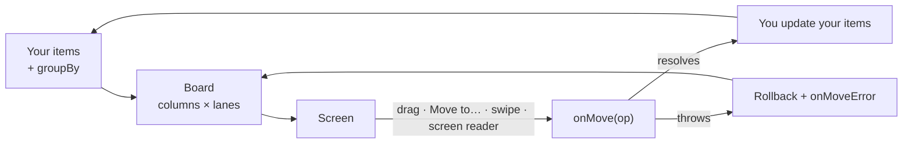
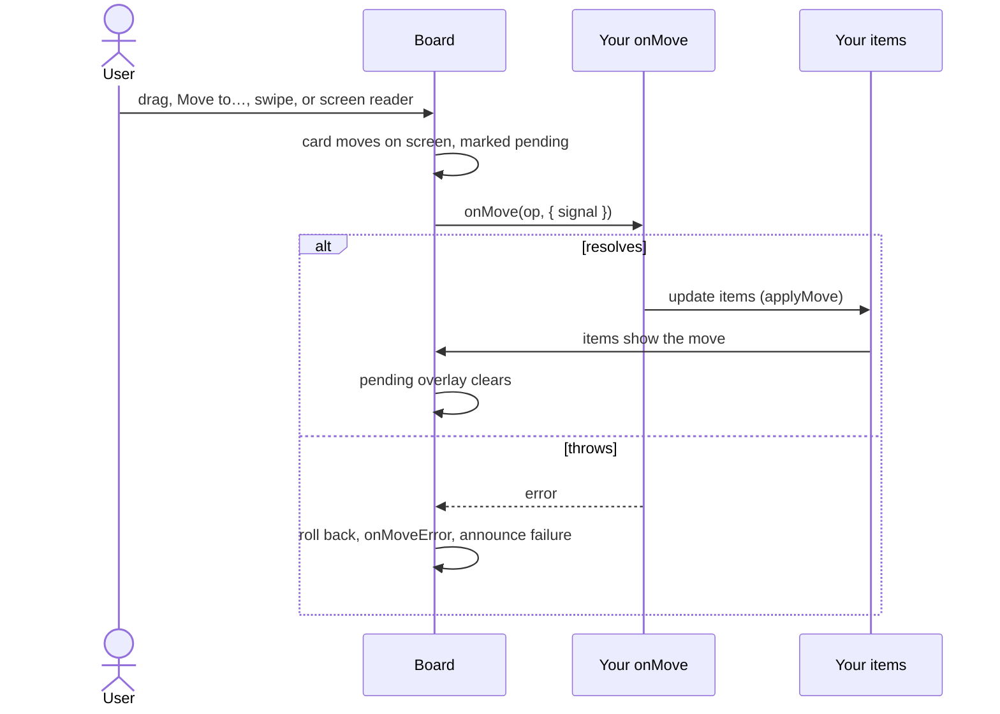

<div align="center">

# react-native-board-view

**Kanban and swimlane boards for React Native and Expo.**<br />
Your items stay the source of truth. The board groups them, and your app accepts or rejects each move.


<!-- github-only -->
[](https://www.npmjs.com/package/react-native-board-view)
<!-- /github-only -->

<table>
  <tr>
    <td align="center"></td>
    <td align="center"></td>
    <td align="center"></td>
  </tr>
  <tr>
    <td align="center"><sub><b>Paged columns</b><br />one column, the next peeks in</sub></td>
    <td align="center"><sub><b>Drag to move</b><br />long-press, lift, drop</sub></td>
    <td align="center"><sub><b>Swimlanes</b><br />cells expand with Show more</sub></td>
  </tr>
</table>

<sub>From the example app. Chips above the board are demo controls, not part of <code>Board</code>.</sub>

[Install](#install) · [Quick start](#quick-start) · [How a move works](#how-a-move-works) · [Layouts](#layouts) · [Props](#props) · [Accessibility](#accessibility) · [Performance](#performance)

</div>

## What you get

| Focus           | What you get                                                                                                      |
| --------------- | ----------------------------------------------------------------------------------------------------------------- |
| **One layout**  | You pass `layout`. The board renders that one mode, not a switcher. `auto` is paged under 600pt, otherwise multi. |
| **Your data**   | Flat items plus `groupBy`. The board never creates, edits, fetches, or stores them.                               |
| **Moves**       | Optimistic, with rollback. The overlay stays until your items show the move.                                      |
| **Virtualized** | FlashList columns. Swimlane cells cap at `cellLimit`, then Show more.                                             |
| **Accessible**  | Move to… sheet and screen-reader actions. Reduced motion and RTL.                                                 |
| **Read only**   | `readOnly` keeps scroll, paging, collapse, and Show more, and turns moves off.                                    |

## How it works

You own the data. The board turns flat items into columns (and optional lanes), and reports every move back to you.



## See it work

### Paged columns

`layout="paged"`, and `auto` on a phone, shows one column with the next one peeking in. The tabs are the board's pager. A sideways swipe changes the column, and the highlighted tab follows.

| Backlog selected, the next column peeks in                                                                                                                              | Swipe to In progress                                                                                                          |
| ------------------------------------------------------------------------------------------------------------------------------------------------------------------- | ----------------------------------------------------------------------------------------------------------------------------- |
|  |  |

### Drag

Long-press a card and move it. The card lifts, a dashed gap marks where it will land, and the drop calls `onMove` with `source: 'drag'`. A long-press that barely moves opens the Move sheet instead of dragging.

| Lifted, with a dashed gap                                                                                                                       | Dropped lower in the column                                                                                    |
| ----------------------------------------------------------------------------------------------------------------------------------------------- | -------------------------------------------------------------------------------------------------------------- |
|  |  |

### Show more

Swimlanes only. `cellLimit` is how many cards a cell paints before Show more. The button is part of the board, and tapping it reveals the next page of that cell. Here the limit is 2, so Alice's Backlog cell shows two cards, then the other two, and the button goes away.

| Before                                                                                                                         | After                                                                                                                |
| ------------------------------------------------------------------------------------------------------------------------------ | -------------------------------------------------------------------------------------------------------------------- |
|  |  |

### Read only

`readOnly` removes the card menu, drag, swipe, and screen-reader move actions. Scroll, paging, collapse, and Show more stay.

| Editable, a "…" move menu on each card | `readOnly`, no menu |
| --- | --- |
|  |  |

## Install

New Architecture. Peers: React Native ≥ 0.83, React ≥ 19, Reanimated ≥ 4.1 &lt; 5, Worklets ≥ 0.5 &lt; 1, Gesture Handler ≥ 2.28 &lt; 4, FlashList ≥ 2.0.2 &lt; 3.

```sh
npx expo install react-native-board-view react-native-reanimated react-native-worklets react-native-gesture-handler @shopify/flash-list
```

Bare React Native: `npm install` the same packages, add `react-native-worklets/plugin` last in `babel.config.js`, then rebuild. Expo Go is untested. Use a [development build](https://docs.expo.dev/develop/development-builds/introduction/).

## Quick start

```tsx
import { useCallback, useState } from 'react';
import { GestureHandlerRootView } from 'react-native-gesture-handler';
import {
  Board,
  CardView,
  applyMove,
  type CardRenderInfo,
  type GroupBy,
  type MoveContext,
  type MoveOperation,
} from 'react-native-board-view';

type Task = { id: string; title: string; status: string | null; rank: string };

const groupBy: GroupBy<Task> = {
  columns: {
    key: 'status',
    values: [
      { id: 'todo', label: 'To do', color: '#64748B' },
      { id: 'doing', label: 'In progress', color: '#2563EB' },
      { id: 'done', label: 'Done', color: '#16A34A' },
    ],
  },
};

export function TaskBoard({ initial }: { initial: Task[] }) {
  const [tasks, setTasks] = useState(initial);
  const onMove = useCallback(async (op: MoveOperation, { signal }: MoveContext) => {
    const response = await fetch(`/api/tasks/${op.id}/move`, {
      method: 'POST',
      body: JSON.stringify({ ...op.changes, rank: op.rank, opId: op.opId }),
      signal,
    });
    if (!response.ok) throw new Error(`Move failed: ${response.status}`);
    setTasks((current) =>
      current.map((task) =>
        task.id === op.id ? applyMove(task, op, groupBy, (item, rank) => ({ ...item, rank })) : task,
      ),
    );
  }, []);
  const renderCard = useCallback(
    ({ item, pending, dragging, compact }: CardRenderInfo<Task>) => (
      <CardView title={item.title} pending={pending} dragging={dragging} compact={compact} />
    ),
    [],
  );

  return (
    <GestureHandlerRootView style={{ flex: 1 }}>
      <Board
        items={tasks}
        getItemId={(task) => task.id}
        getItemLabel={(task) => task.title}
        groupBy={groupBy}
        onMove={onMove}
        renderCard={renderCard}
      />
    </GestureHandlerRootView>
  );
}
```

`Board` includes its own `GestureHandlerRootView`. Keep one on the app root as well. Items need a string `rank`, or pass `getRank`. Seed missing ranks with the [recipe](https://github.com/vishaal2002/react-native-board-view/blob/main/docs/recipes.md#seeding-ranks).

## Read only

```tsx
<Board readOnly items={tasks} getItemId={(task) => task.id} groupBy={groupBy} onMove={onMove} renderCard={renderCard} />
```

Scrolling, column paging, lane and column collapse, and Show more still work. Long-press drag, swipe, the Move sheet, and screen-reader move actions do not. `onMove` is not called. `onMove` stays required so the same board can leave read-only mode without a remount.

## How a move works



`onMove` receives one `MoveOperation`: `opId`, `id`, `changes` (only fields that change; `null` is the No value bucket), `from`, `rank` ([fractional index](https://github.com/rocicorp/fractional-indexing)), `previousId`, `nextId`, and `source` (`drag`, `sheet`, `swipe`, `accessibility`, `api`).

1. The card moves on screen at once and stays `pending`.
2. Same-item moves run one at a time. Different items run in parallel.
3. Resolve `onMove` when the server accepts it. The overlay clears once `items` show that move, or after `settleTimeoutMs` (5s).
4. Throw to roll the card back, cancel later moves of that item, fire `onMoveError`, and announce the failure.
5. Past `inflightTimeoutMs` (30s) the move rejects with `MoveTimeoutError` and aborts `signal`. Use `0` when `onMove` waits on the user.

More patterns, including a shared server model: [docs/recipes.md](https://github.com/vishaal2002/react-native-board-view/blob/main/docs/recipes.md).

## Layouts

Pass one value. The board does not show the other layouts, and it does not render a control for switching them.

| `layout`  | Behavior                                                                    |
| --------- | --------------------------------------------------------------------------- |
| `auto`    | `paged` under 600pt, otherwise `multi`.                                     |
| `paged`   | One column per page, peek, snap, tabs or dots. An edge drag flips the page. |
| `multi`   | Fixed-width columns, sideways scroll.                                       |
| `fit`     | Columns share the width down to `minColumnWidth`, then scroll.              |
| `stacked` | One vertical list, a section per column.                                    |

Sketches of the structure, not screenshots:

```text
paged: one column per page, the next peeks in
┌──────────────────────────┐
│ [To do]  Doing   Done    │  tabs
├────────────────────┬─────┤
│ [ card ]           │ [ c │
│ [ card ]           │ [ c │
└────────────────────┴─────┘

multi / fit: columns side by side, scroll sideways
┌───────────┬───────────┬───────────┐
│ To do     │ Doing     │ Done      │
├───────────┼───────────┼───────────┤
│ [ card ]  │ [ card ]  │ [ card ]  │
│ [ card ]  │ [ card ]  │           │
└───────────┴───────────┴───────────┘

stacked: one vertical list, a section per column
┌──────────────────────┐
│ v To do              │
│   [ card ]           │
│   [ card ]           │
│ > Doing (collapsed)  │
│ v Done               │
│   [ card ]           │
└──────────────────────┘

swimlanes: a second axis, groupBy.lanes
┌───────┬──────────┬──────────┐
│       │ To do    │ Doing    │
├───────┼──────────┼──────────┤
│ Alice │ [ card ] │ [ card ] │
├───────┼──────────┼──────────┤
│ Bob   │ [ card ] │          │
└───────┴──────────┴──────────┘
```

Swimlanes are a second axis, `groupBy.lanes`. Lanes virtualize and collapse. Each cell shows `cellLimit` cards (default 50), then Show more. A cross-lane drop changes both fields in one operation. Unknown or `null` values land in a No value column or lane (`labels.noValue`).

## Props

| Prop                                                                                                     | Default                      | Notes                                                                                |
| -------------------------------------------------------------------------------------------------------- | ---------------------------- | ------------------------------------------------------------------------------------ |
| `items`, `getItemId`, `groupBy`, `onMove`, `renderCard`                                                  |                              | Required.                                                                            |
| `getRank`                                                                                                | `item.rank`                  | Missing rank sorts first.                                                            |
| `getItemLabel`                                                                                           | id                           | Screen reader and Move sheet.                                                        |
| `readOnly`                                                                                               | `false`                      | Display only.                                                                        |
| `moveModes`                                                                                              | drag and sheet on, swipe off | `drag: false`, `sheet: 'manual' \| false`, `swipe: 'auto'` (`multi` and `fit` only). |
| `canDrag`, `canDrop`                                                                                     | allow                        | Locked cards, refused cells.                                                         |
| `onMoveError`, `onDragStart`, `onDragOver`, `onDragEnd`                                                  |                              | Rollback and drag hooks.                                                             |
| `layout`                                                                                                 | `auto`                       | `paged`, `multi`, `fit`, `stacked`.                                                  |
| `columnId`, `onColumnChange`                                                                             |                              | Set the column on screen. Update `columnId` from the callback when the user swipes. |
| `onEndReached`                                                                                           |                              | A column list hit its end. The board does not fetch.                                 |
| `pagerIndicator`                                                                                         | `tabs`                       | `dots`, `none`.                                                                      |
| `cellLimit`                                                                                              | `50`                         | Swimlane cards before Show more.                                                     |
| `appearance`                                                                                             | `auto`                       | `light`, `dark`.                                                                     |
| `density`                                                                                                | `comfortable`                | `compact`.                                                                           |
| `theme`, `labels`                                                                                        | built-in                     | Partial overrides. `useBoardTheme()` inside cards.                                   |
| `settleTimeoutMs`, `inflightTimeoutMs`                                                                   | 5000, 30000                  | `0` waits.                                                                           |
| `collapsibleColumns`                                                                                     | on in `stacked`              | Also `collapsedColumns` / `collapsedLanes` plus change callbacks.                    |
| `autoScroll`, `longPressDelay`                                                                           | on, 200ms                    |                                                                                      |
| `renderColumnHeader`, `renderLaneHeader`, `renderEmptyCell`, `renderColumnFooter`, `renderDropIndicator` |                              | Optional chrome.                                                                     |
| `ref`                                                                                                    |                              | `scrollToColumn`, `scrollToItem`, `openMoveSheet`, `closeMoveSheet`.                 |

Keep `renderCard` and `groupBy` stable. `CardView` accepts `title`, `description`, `tags`, `meta`, `assignee`, `accentColor`, `pending`, `dragging`, `compact`, and `onPress`.

```tsx
<Board theme={{ accent: '#7C3AED', radius: 16, columnWidth: 280 }} labels={{ noValue: 'Unassigned' }} />
```

## Accessibility

Each card is one element: item, column, lane, and position. Actions are Move to…, Move to a column, and Move to a lane. The sheet lists allowed destinations. A successful move is announced when `onMove` resolves. Focus follows a sheet or screen-reader move. `readOnly` removes those move actions and keeps the label.

## Performance

On a Pixel 9 Pro emulator, release build, 4 × 500 cards, holding a card measured 60 fps median on both threads. Auto-scroll tracks FlashList cell rendering, same as a finger scroll. Method and the rest of the table: [docs/benchmarks.md](https://github.com/vishaal2002/react-native-board-view/blob/main/docs/benchmarks.md). Memoize cards, and filter items before they reach the board.

## 0.3.0

- Paged Show more draws on the column that is on screen. The next column still peeks in.
- `columnId` sets that column. `onEndReached` reports a column list that hit its end, and the board does not fetch.

## 0.2.0

- Show more reveals the next page of cards in a swimlane cell.
- Paged column tabs match the column on screen after a layout change.
- `readOnly`.

Captures above are from `apps/bare` on a Pixel 9 Pro emulator (Android 17, arm64), debug build, 2026-10-10. Show more was checked there: a cell limited to 2 cards showed the rest after the tap. The drag clip lifts Review billing page, opens a dashed gap, and drops it lower in Backlog. The paging clip swipes from Backlog to In progress. These clips are not a release-build performance run.

**Still open**

- Phone benchmarks on a mid-tier Android device and an iPhone. The only release table is the emulator run in [docs/benchmarks.md](https://github.com/vishaal2002/react-native-board-view/blob/main/docs/benchmarks.md).
- A five-person pass with developers who have not used the package. One emulator session is written up in [docs/usability.md](https://github.com/vishaal2002/react-native-board-view/blob/main/docs/usability.md).
- 1.0 device gates in [docs/spike.md](https://github.com/vishaal2002/react-native-board-view/blob/main/docs/spike.md). S4, S7, and physical-device performance are still open.

The playground is `apps/example` or `apps/bare`.

## Out of scope

No create, edit, delete, fetch, or offline store. No rank rebalancing in the client (`shouldRebalance`, `rebalanceRanks` are there for your server). No WIP-limit prop, sub-columns, column reorder, or multi-select. One cell per item. No Reanimated 3, no old architecture, no web.

## Packages

| Package                   | Role                                                                     |
| ------------------------- | ------------------------------------------------------------------------ |
| `react-native-board-view` | `Board`, and a re-export of the core. **0.3.0.**                         |
| `board-view-core`         | Grouping, ranks, move planning, and the move queue. No React. **0.1.0.** |

[Recipes](https://github.com/vishaal2002/react-native-board-view/blob/main/docs/recipes.md) · [Contributing](https://github.com/vishaal2002/react-native-board-view/blob/main/CONTRIBUTING.md)

MIT
